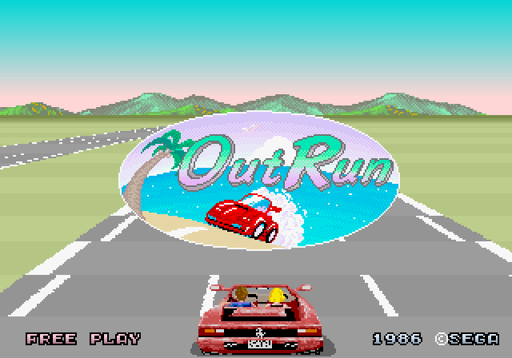
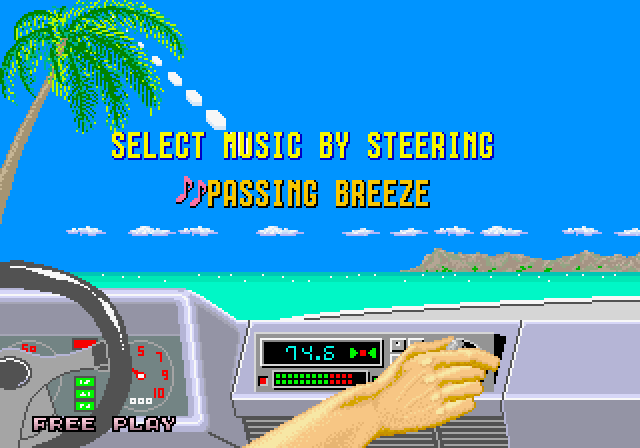
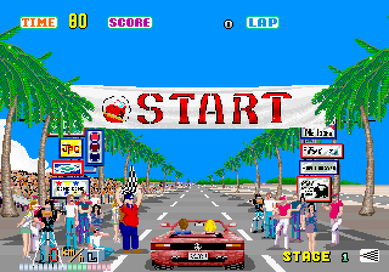
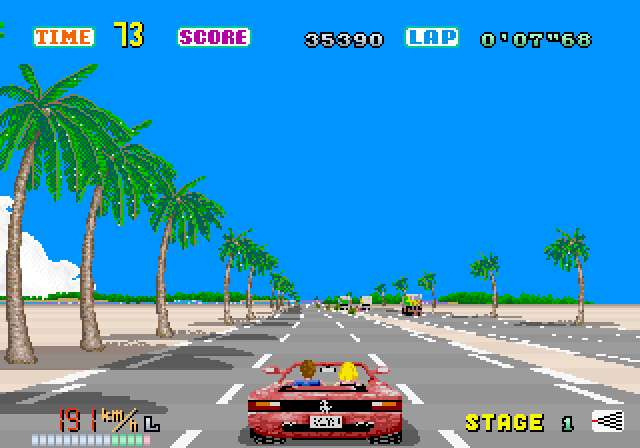
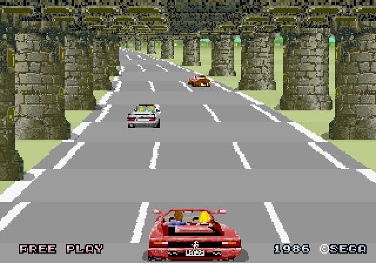
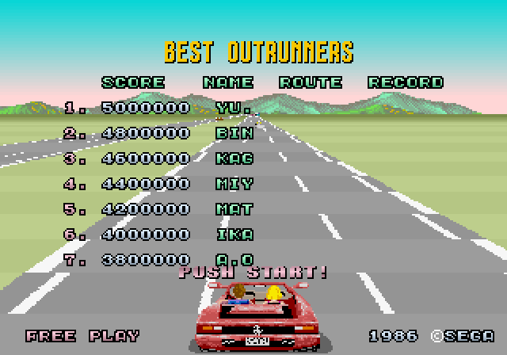
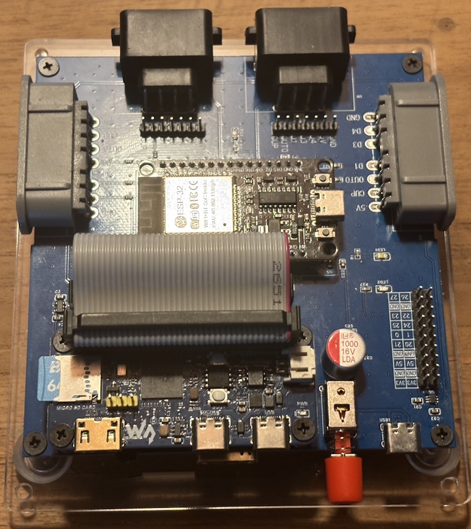
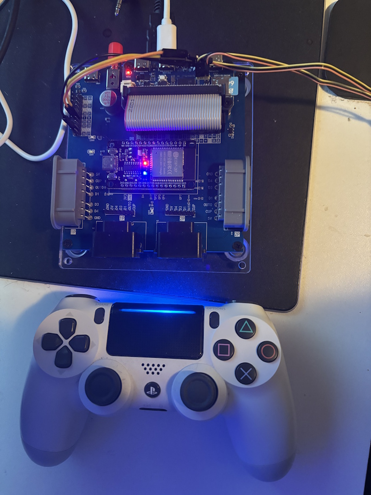
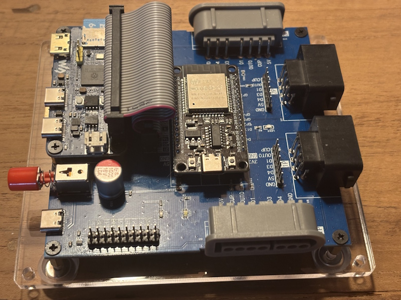
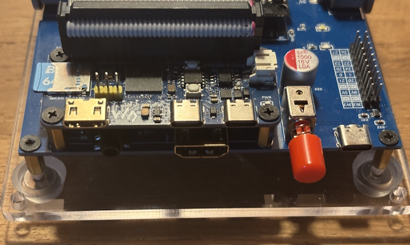

# pico-outrun

> [!NOTE]
> Version 0.7 is the current release. Binaries for the seven supported configurations are available on the [Releases](https://github.com/PicoPlus-devel/pico-outrun/releases) page.

**pico-outrun** is a port of the arcade game **OutRun** to RP2350-based microcontroller boards with PSRAM, with video and audio over HDMI. The game engine is [Cannonball](https://github.com/djyt/cannonball) by Chris White, in which the original 68000 and Z80 assembler has been rewritten in C++. This is therefore a native port rather than an arcade emulator: the code runs directly on the RP2350 and only the artwork, sound samples and level data come from the original ROMs.

It uses the same menu, display, audio and controller framework as this family of emulators:

- NES: [pico-infonesPlus](https://github.com/PicoPlus-devel/pico-infonesPlus)
- Super Nintendo: [pico-snesPlus](https://github.com/PicoPlus-devel/pico-snesPlus)
- Sega Master System / Game Gear: [pico-smsplus](https://github.com/PicoPlus-devel/pico-smsplus)
- Game Boy / Game Boy Color: [pico-peanutGB](https://github.com/PicoPlus-devel/pico-peanutGB)
- Sega Mega Drive / Genesis: [pico-genesisPlus](https://github.com/PicoPlus-devel/pico-genesisPlus)

It runs on seven hardware configurations — see [Supported hardware](#supported-hardware):

- [Adafruit Fruit Jam](https://www.adafruit.com/product/6200) — the primary development and test board
- [Pimoroni Pico Plus 2](https://shop.pimoroni.com/products/pimoroni-pico-plus-2?variant=42092668289107) with an [Adafruit DVI breakout](https://www.adafruit.com/product/4984) and a microSD breakout, on a breadboard or on the [PicoNES PCB](#picones-pcb)
- [Murmulator M2](https://murmulator.ru)
- [Adafruit Feather RP2350 with HSTX Port](https://www.adafruit.com/product/6130) with a TLV320DAC3100 I2S DAC and a microSD breakout
- [Olimex RP2040-PICO-PC](https://www.olimex.com/Products/MicroPython/PICO/RP2040-PICO-PC/) with a Raspberry Pi Pico 2 compatible board that has 8 MB of PSRAM
- [Pico Computer 3](https://github.com/UKTailwind/Pico-Computer-3)
- [PCB for the Waveshare RP2350-PiZero](https://github.com/PicoPlus-devel/pico-infonesPlus#pcb-with-waveshare-rp2350-pizero), designed by Liu Szuping, with an 8 MB PSRAM chip soldered onto the RP2350-PiZero

All seven are RP2350 boards with 8 MB of PSRAM, which this port requires: a plain Raspberry Pi Pico 2 has none and cannot be used.

**The OutRun ROM set is not included and must be supplied by the user.** It is copyright SEGA and is not distributed with this project. See [Game data](#game-data).

***

## Getting started

1. **Flash the game.** Download the `.uf2` for your board from the [Releases](https://github.com/PicoPlus-devel/pico-outrun/releases) page; the table under [Supported hardware](#supported-hardware) gives the file name for each board. Hold BOOTSEL, connect the board over USB, and copy the `.uf2` onto the `RP2350` drive that appears.
2. **Prepare the SD card.** Format a microSD card as FAT32 (recommended) or exFAT.
3. **Run `updateAll`.** Download `updateAll.exe` from the same Releases page and start it on a Windows 10 or 11 computer with the card inserted. Check under **SD card** that the card is selected, untick the sets that are not wanted — pico-outrun needs only **OutRun** — and select **Install**. `updateAll` takes `outrun.zip` from the folder chosen under **Zip folder**, or downloads it when it is not there, and writes the ROM set into `/roms/ORUN` under the file names the application expects. Windows may report that the program is not signed: select **More info**, then **Run anyway**. On Linux or macOS, use the Python version from [pico-bootLoader](https://github.com/PicoPlus-devel/pico-bootLoader/tree/main/updateAll) instead: `python3 updateAll.py --core outrun --sd <path of the card>`. The ROM set is not part of this project, and holding the rights to it is the user's responsibility; [Game data](#game-data) describes how to use only a zip you already have, or how to copy the files by hand.
4. **Run it.** Insert the card and power on the board. The application builds the game data from the ROM set in PSRAM, which takes a few seconds and shows a progress bar, and then starts the game in attract mode. Press **Start** to play.

With the ROM set on the SD card, the game data is prepared again every time the board starts, which takes a few seconds. Alternatively, the game data can be converted on a computer and flashed to the board once, alongside the game. The game then starts immediately and no SD card is needed. This conversion requires the Pico SDK; see [Game data](#game-data).

***

## Screenshots

The game as the port draws it, at twice the original 320x224 resolution. On the board the picture is centred in the 320x240 display, with eight blank lines above and below it. The pictures were captured with the [host-side test harness](#host-side-test-harness), which runs the same engine and game data as the firmware.

<table>
  <tr>
    <td></td>
    <td></td>
  </tr>
  <tr>
    <td align="center">Title screen</td>
    <td align="center">Selecting the music on the car radio</td>
  </tr>
  <tr>
    <td></td>
    <td></td>
  </tr>
  <tr>
    <td align="center">The start line</td>
    <td align="center">Coconut Beach, the first stage</td>
  </tr>
  <tr>
    <td></td>
    <td></td>
  </tr>
  <tr>
    <td align="center">The stone arches of the second stage, in attract mode</td>
    <td align="center">Best OutRunners</td>
  </tr>
</table>

***

## Status and limitations

> [!NOTE]
> This is work in progress. The game runs from attract mode through to a full race with music and sound effects, but it is not finished, and how well it plays is still changing from commit to commit.

Worth knowing before you start:

- **Full speed is not held yet.** Driving a 68000-era arcade game on a microcontroller is demanding, and the frame rate and with it the game speed still vary with what is on screen. Tuning the balance between the engine tick and the renderer is where the current work is; expect the speed to change, in both directions, while that continues.
- **There is no ROM browser.** The board boots straight into OutRun. There is only one game, so there is nothing to choose from and no file menu.
- **No save states, and high scores are not kept.** A high score survives until the board is reset or powered off.
- **Steering is digital.** The analog stick of a USB gamepad steers in the same way as the d-pad; proportional steering is not supported yet. See [Controllers](#controllers).
- Development and testing take place primarily on the Adafruit Fruit Jam. The other supported boards need to be more thoroughly tested.

***

## Game data

OutRun's ROM data is copyright SEGA and is not distributed with this project. You have to supply it yourself, from a set you legally own. Required is the MAME **`outrun` revision B parent set**: 31 files, roughly 2.2 MB. [tools/README.md](tools/README.md) lists every file and what it contains.

The tile, sprite and road ROMs are stored in a packed arcade-specific layout and have to be decoded before they can be drawn. Cannonball does that at startup into approximately 1.5 MB of RAM, which an RP2350 does not have, so pico-outrun stores the decoded result as a single data image. There are two ways to provide that image.

### 1. ROM set on the SD card, installed with updateAll (recommended)

The ROM set is placed in `/roms/ORUN` on the SD card, and the application builds the data image from it in PSRAM at startup, showing a progress bar while it does. This takes a few seconds on every boot and needs roughly 2.7 MB of free PSRAM, but requires nothing on the computer other than `updateAll`.

`updateAll.exe`, a program for Windows 10 and 11, is included in every release of pico-outrun from v0.5.1 on, among the files at the end of the release page. It runs on a computer with the SD card inserted: it takes `outrun.zip` from a folder of your choice, or downloads it when it is not there, and writes the set, unzipped and under the file names the application expects, into `/roms/ORUN`. It is a single file and needs no installation. The program is not signed, so Windows may show "Windows protected your PC" the first time it is started; select **More info**, then **Run anyway**.

1. Start `updateAll.exe`. It selects a removable drive by itself; under **SD card**, check that it is the card, or choose another.
2. Under **Zip folder**, choose the folder with the MAME zips you already have, if any.
3. Untick the sets that are not wanted. updateAll also installs the sets of other applications of this family, such as pico-galagino and pico-phoenix; pico-outrun needs only the set **OutRun**. The **Status** column shows which sets are already complete on the card.
4. Select **Install**.

By default, zips that are not in the zip folder are downloaded from [ArcadeROMsDB_MiSTer](https://github.com/zakk4223/ArcadeROMsDB_MiSTer), a third-party database that is not part of this project. The user is responsible for holding the rights to the ROM sets, whether they are supplied as zips or downloaded. To use only your own zips, untick **Download missing files**.

updateAll is maintained in [pico-bootLoader](https://github.com/PicoPlus-devel/pico-bootLoader), whose SD-card archive carries it as well. The same installer is also available there as a Python script, `updateAll.py`, for Linux and macOS, and as a PowerShell script, `updateAll.ps1`. The [updateAll README](https://github.com/PicoPlus-devel/pico-bootLoader/blob/main/updateAll/README.md) describes all three and their options.

The files can also be copied to the card by hand. They must be extracted, since zip archives are not read, and carry the file names listed in [tools/README.md](tools/README.md). `/roms/ORUN/outrun` is searched as well, since extracting a MAME set commonly produces that layout.

### 2. Data image in flash

[tools/mkoutrundata.sh](tools/mkoutrundata.sh) converts a ROM set into `outrun-data.uf2`, a data image that is flashed once, to a fixed address just after the application, and read directly from flash while the game runs. The game then starts immediately and no SD card is needed to play, but making the image requires the Pico SDK.

```sh
./bld.sh -m -c 8 -2                    # once, to establish the flash address
tools/mkoutrundata.sh ~/roms/outrun    # writes outrun-data.uf2
```

The first command only configures the build, to establish the flash address the data image is written to; see [Building from source](#building-from-source). The address is the same for all five supported configurations, so one data image works with every released binary.

Flash `outrun-data.uf2` the same way as the application, over BOOTSEL or with `picotool`. It only has to be flashed again when it changes, so reflashing the application later leaves the game data in place. When a data image is present in flash, the application uses it and does not look for the ROM set on the SD card.

### Checks and error reporting

Each file is checked against its expected CRC with both methods, so an incomplete set, a corrupt file or a different revision is reported by name rather than producing a subtly incorrect image.

If the game data is found neither in flash nor on the SD card, the application displays a screen describing what is missing and what to do about it — no PSRAM, no SD card, no ROMs in the directory it looked in, files missing from the set, or a CRC mismatch. The settings menu remains reachable with **Select + Start** from that screen, so [USB drive mode](#usb-drive-mode) can be used to put the ROM set on the card, and BOOTSEL mode can be entered without unplugging the board.

***

## Supported hardware

An RP2350 board with 8 MB of PSRAM is required, and video must run over HSTX. Only the seven hardware configurations below are supported.

| HW_CONFIG | Hardware | Binary |
| --- | --- | --- |
| 2 | [Pimoroni Pico Plus 2](https://shop.pimoroni.com/products/pimoroni-pico-plus-2?variant=42092668289107) with [Adafruit DVI Breakout](https://www.adafruit.com/product/4984) and a microSD breakout, on a breadboard or on the [PicoNES PCB](#picones-pcb) | `picoOutRun_AdafruitDVISD_pico2_arm.uf2` |
| 8 | [Adafruit Fruit Jam](https://www.adafruit.com/product/6200) (primary development and test board) | `picoOutRun_AdafruitFruitJam_arm_piousb.uf2` |
| 13 | [Murmulator M2](https://murmulator.ru) | `picoOutRun_MurmulatorM2_arm.uf2` |
| 14 | [Adafruit Feather RP2350 with HSTX Port](https://www.adafruit.com/product/6130) with TLV320DAC3100 I2S DAC and microSD breakout | `picoOutRun_AdafruitFeatherRP2350_TLV320DAC3100_arm_piousb.uf2` |
| 15 | [Olimex RP2040-PICO-PC](https://www.olimex.com/Products/MicroPython/PICO/RP2040-PICO-PC/) with a Raspberry Pi Pico 2 compatible board that has 8 MB of PSRAM | `picoOutRun_OlimexPicoPC_arm.uf2` |
| 17 | [Pico Computer 3](https://github.com/UKTailwind/Pico-Computer-3) | `picoOutRun_PicoComputer3_arm.uf2` |
| 18 | [PCB for the Waveshare RP2350-PiZero](https://github.com/PicoPlus-devel/pico-infonesPlus#pcb-with-waveshare-rp2350-pizero) with an 8 MB PSRAM chip soldered onto the RP2350-PiZero | `picoOutRun_WaveShareRP2350PiZeroLiuPCB_arm_piousb.uf2` |

Notes per configuration:

- **HW_CONFIG 2**: a plain Raspberry Pi Pico 2 does not work — it has no PSRAM. The Pimoroni Pico Plus 2 (with onboard PSRAM) is required. The [PicoNES PCB](#picones-pcb) is the tidy version of this configuration; it needs design v2.6 or v2.8, the designs that can host a Pimoroni Pico Plus 2. The two builds take different microSD breakouts: on a breadboard the [Adafruit Micro-SD breakout board+](https://www.adafruit.com/product/254), on the PCB the smaller [Adafruit Micro SD SPI or SDIO breakout](https://www.adafruit.com/product/4682), which is the footprint the board is laid out for.
- **HW_CONFIG 8**: no additional hardware is required apart from a USB game controller. Button 2 switches the NeoPixel VU meter on and off.
- **HW_CONFIG 14**: the Feather RP2350 is sold in two variants: [with 8 MB PSRAM onboard](https://www.adafruit.com/product/6130) and [without PSRAM](https://www.adafruit.com/product/6000). On the variant without PSRAM, a PSRAM chip must be soldered onto the board separately.
- **HW_CONFIG 15**: a standard Raspberry Pi Pico 2 does not work — it has no PSRAM. The board fitted must have 8 MB of PSRAM with its chip select on GPIO 8. A NES or SNES controller can be connected to the UEXT connector: clock on GPIO 5, latch on GPIO 9 and data on GPIO 20. There is only one controller port and no Wii Classic controller support. There is no Pico 2 W binary. Support for this board was contributed by [DnCraptor](https://github.com/DnCraptor).
- **HW_CONFIG 17**: the Pico Computer 3 has 8 MB of PSRAM on the board. Up to two NES or SNES controllers and a Wii Classic controller connect to its I/O header H4; the pins are listed under [Pico Computer 3](https://github.com/PicoPlus-devel/pico-infonesPlus#pico-computer-3) in the pico-infonesPlus readme. The pin assignment may still change. Support for this board was contributed by [javavi](https://github.com/javavi).
- **HW_CONFIG 18**: a PCB for the [Waveshare RP2350-PiZero](https://www.waveshare.com/rp2350-pizero.htm), designed by Liu Szuping ([szuping](https://github.com/szuping)); the PCB design is not yet available. The RP2350-PiZero comes without PSRAM, so an 8 MB PSRAM chip must be soldered onto it. If its flash chip is not a Winbond chip, apply the [flash_config fix](https://github.com/PicoPlus-devel/pico-infonesPlus#psram-with-a-non-winbond-flash-chip) before flashing the game. Video goes through the HDMI port of the PCB, not the mini HDMI port of the RP2350-PiZero. A USB controller connects to the PIO-USB port of the RP2350-PiZero, and up to two NES or SNES controllers to the controller ports of the PCB. With an ESP32 module running [BlueRetro](https://github.com/darthcloud/blueretro) in the socket of the PCB, Bluetooth controllers are used instead of the controller ports; remove the module to use the ports. See [PCB with Waveshare RP2350-PiZero](https://github.com/PicoPlus-devel/pico-infonesPlus#pcb-with-waveshare-rp2350-pizero) in the pico-infonesPlus readme.
- **Audio** is sent over HDMI by default. Configurations 8, 13, 14, 17 and 18 also have an I2S audio output, selected with *External Audio* in the settings menu; on the Fruit Jam, plugging in headphones selects it automatically. Configuration 2 has HDMI audio only. Configuration 15 plays sound through HDMI and the board's audio jack at the same time.

> [!IMPORTANT]
> Unlike the sister projects, the build does not refuse a configuration without PSRAM: the other board configurations known from those projects still compile and flash. They will not run. A board without PSRAM reports *"This board has no PSRAM. picoOutRun cannot run on it."* at startup, and the configurations that fall back to the bit-banged PicoDVI driver are too slow for the engine — see [Overclocking](#overclocking).

The [PCB for the Waveshare RP2350-PiZero](https://github.com/PicoPlus-devel/pico-infonesPlus#pcb-with-waveshare-rp2350-pizero) (HW_CONFIG 18), designed by Liu Szuping:

|  |  |
|:--:|:--:|
|  |  |

For wiring and assembly instructions, see the setup sections of the [pico-infonesPlus README](https://github.com/PicoPlus-devel/pico-infonesPlus#setup); for the PCB version of HW_CONFIG 2, see [PicoNES PCB](#picones-pcb) below. Flashing works the same for every board: hold BOOTSEL while connecting the board over USB, then copy the `.uf2` file onto the USB drive that appears.

***

## Overclocking

All seven supported configurations run at **384 MHz at 1.50 V**. Cannonball runs single-core: core1 is owned by the display driver and the sound chain, so all of the engine and rendering headroom has to come out of the core clock. That clock is what makes the port viable at all, and there is no user-selectable overclock. The sister projects offer it in the settings menu of their ROM browser; this port has no ROM browser, and the entry is not enabled in its in-game menu.

That clock is also why the board configurations driven by the bit-banged PicoDVI driver are not supported. There the system clock is tied to the pixel clock and cannot exceed 324 MHz, and without the HSTX driver's background task the sound chain moves back onto core0, so audio quality follows the frame rate. `./bld.sh -D` still forces that path on an HSTX-capable board, and the remaining board configurations in `pico_shared` still build, but neither is a supported way to run this port. Most of those boards have no PSRAM either.

Use this software at your own risk. I am not responsible in any way for damage to your board and/or connected peripherals caused by using this software or by incorrect wiring or voltages.

***

## Custom PCB

The PicoNES PCB turns the HW_CONFIG 2 breadboard build into a small console. It carries the microcontroller board, the DVI and microSD breakouts and two controller ports. It comes in two versions, which differ only in the controller ports: **v2.6** with NES controller ports and **v2.8** with SNES controller ports. For this port, both versions need a Pimoroni Pico Plus 2 mounted on male headers. Parts lists, assembly notes, the pin assignment and the 3D-printed case are described in the [PCB README](https://github.com/PicoPlus-devel/pico_shared/blob/main/PCB/README.md). Both Gerber files are attached to every [release](https://github.com/PicoPlus-devel/pico-outrun/releases/latest) of this project.

| Design | Picture | Controller ports | Designed by |
| ------ | ------- | ---------------- | ----------- |
| [PicoNES v2.6](#picones-pcb) | <br><sub>See note</sub> | 2 × NES | [John Edgar Park](https://twitter.com/johnedgarpark) |
| [PicoNES v2.8](#picones-pcb) | <br><sub>See note</sub> | 2 × SNES | [John Edgar Park](https://twitter.com/johnedgarpark) |

> [!NOTE]
> The PicoNES v2.6 and v2.8 are shown with a Pimoroni Pico Plus 2. This port needs the PSRAM of the Pimoroni Pico Plus 2, so no other board can be fitted.

The other designs in the PCB README cannot be used with this port. The PicoNES Mini and PicoNES Micro are built around Waveshare boards without PSRAM, and on designs v2.1 and older the microcontroller board must lie flat on the PCB, which the Pimoroni Pico Plus 2 cannot.

> [!NOTE]
> Sellers on AliExpress have copied the PicoNES design and sell ready-made boards. For questions about those, contact the seller.

### PicoNES PCB

> [!IMPORTANT]
> For this project the PCB only works with a [Pimoroni Pico Plus 2](https://shop.pimoroni.com/products/pimoroni-pico-plus-2?variant=42092668289107), mounted on male headers. The Raspberry Pi Pico, Pico 2 and Pico 2 W in the parts list of the PCB README have no PSRAM and cannot run pico-outrun. Optional female socket headers, soldered into the PCB, let the board be plugged in and swapped without desoldering.

OutRun is a single-player game. A USB controller, or a controller in either GPIO controller port, can be used; see [Controllers](#controllers). On v2.8, original SNES controllers plug in directly; on v2.6, NES controllers do. The controller ports are optional when a USB controller is used.

The microSD card is only needed for the SD-card route to the [game data](#game-data); with the data image flashed, the game runs without a card. Audio is carried over HDMI.

Flash `picoOutRun_AdafruitDVISD_pico2_arm.uf2`, the same file as the breadboard build, since the PCB is the same hardware configuration.

The parts lists and assembly notes are in the PCB README: [PicoNES v2.6](https://github.com/PicoPlus-devel/pico_shared/blob/main/PCB/README.md#picones-v26-nes-controller-ports) and [PicoNES v2.8](https://github.com/PicoPlus-devel/pico_shared/blob/main/PCB/README.md#picones-v28-snes-controller-ports).

| NES controller ports (v2.6) | SNES controller ports (v2.8) |
| --------------------------- | ---------------------------- |
|  |  |

#### 3D printed case

Gavin Knight ([DynaMight1124](https://github.com/DynaMight1124)) designed an NES-like case for the v2.6 PCB: [thingiverse.com/thing:6689537](https://www.thingiverse.com/thing:6689537). It does not fit the v2.8 PCB. Two top covers are available, one with a button that presses the BOOTSEL button for firmware updates and one without. All parts are shown in the [PCB README](https://github.com/PicoPlus-devel/pico_shared/blob/main/PCB/README.md#3d-printed-case). For questions about the case, please contact the designer on the Thingiverse page.

> [!IMPORTANT]
> Download the **latest** top cover. The Pimoroni Pico Plus 2 is always mounted on headers here, and headers raise the board. Only the newest cover leaves room for the USB cable; the older ones assume a Pico soldered flat onto the PCB.

| Top cover | Base |
| --------- | ---- |
|  |  |

***

## SD card setup

With the recommended method, the SD card holds the ROM set. Only when the game data has been flashed can the game run without a card; a missing card is then not an error.

A card is used for two things:

1. **The ROM set.** Format the card as FAT32 (recommended) or exFAT and install the set into `/roms/ORUN` with `updateAll`, or copy the extracted OutRun ROM files there by hand. The folder is created automatically on first boot. See [Game data](#game-data).
2. **Settings.** Screen mode, audio output and the other options from the settings menu are stored in `/settings_ARC.dat` in the root of the card and are remembered across restarts. The file is shared by all arcade games of this family. Without a card the settings revert to their defaults on every boot.

There are no save files: the game has no save states, and high scores are not written to the card.

Files can be added or removed later without taking the card out of the board; see [USB drive mode](#usb-drive-mode).

***

## USB drive mode

The SD card can be handed to a computer as an ordinary USB mass storage device, so the ROM set can be copied onto it without moving the card to a card reader.

Press **Select + Start** to open the settings menu, select **USB drive mode**, and connect the board's USB port to a computer. The card is unmounted and appears on the computer as a removable drive. Copy or delete files, then eject the drive on the computer: the card is remounted and the game resumes.

**B** also leaves the screen. If no computer has claimed the drive within twenty seconds, it closes by itself.

Points to note:

- The entry is also available on the screen that reports missing game data, which is how a ROM set gets onto the card on a board that has never run the game.
- Eject the drive on the computer before leaving the screen, as with any removable drive.
- Gamepads on the GPIO controller ports, and USB controllers on boards that have a second USB port for them, keep working while the card is mounted.
- A board with only one USB port needs that port for the computer, and is powered through it, so a USB controller cannot be attached at the same time and the cables cannot be exchanged while the game is running. Connect the board to the computer first and open the screen with a gamepad on a GPIO controller port.
- The card must be readable when the screen is opened. A missing or unreadable card is reported instead.

***

## Controllers

| Controller | What works |
| --- | --- |
| USB gamepad (XInput, DualShock 4 / DualSense, generic HID, 8BitDo) | Everything — steering, accelerate, brake, gear, Start and Coin, and the settings menu. Buttons are read by position, so the right-hand face button accelerates, the bottom one brakes and the top one changes gear: **B / A / Y** on an Xbox pad, **Circle / Cross / Triangle** on a PlayStation pad. The d-pad steers, and so does the left analog stick, but only digitally, in the same way as the d-pad. |
| USB keyboard | Playable: **X** accelerates, **Z** brakes, **C** changes gear, **S** is Start, **A** is Coin, and the arrow keys steer. |
| SNES controller on the GPIO port | Everything: **A** accelerates, **B** brakes, **X** changes gear. |
| NES controller on the GPIO port | Everything: **A** accelerates, **B** brakes. The NES controller has no third button, so **Select** changes gear; it also acts as the coin button. |
| Wii Classic / SNES-Classic-mini pad (I2C port) | Everything, with the same button labels as the SNES controller. |

OutRun is a single-player game, so every controller drives the same car: the first USB gamepad or keyboard, both GPIO controller ports and the Wii port are combined into one input. Each GPIO port is read separately, so the two ports may hold different types of controller.

See the [pico-infonesPlus README](https://github.com/PicoPlus-devel/pico-infonesPlus#gamecontroller-support) for general controller notes and troubleshooting.

***

## In-game controls

| Action | SNES / Wii Classic | Xbox pad | PlayStation pad | NES controller | Keyboard |
| --- | --- | --- | --- | --- | --- |
| Steer | D-pad Left/Right | Stick / d-pad | Stick / d-pad | D-pad | Arrow keys |
| Accelerate | A (right-hand face button) | B | Circle | A | X |
| Brake | B (bottom face button) | A | Cross | B | Z |
| Gear (high/low) | X (top face button) | Y | Triangle | Select | C |
| Start | Start | Menu | Options | Start | S |
| Insert coin | Select | View | Share | Select | A |
| Settings menu | Select + Start | View + Menu | Share + Options | Select + Start | A + S |

The machine is set to free play, so Start alone begins a game; the coin button is there for completeness.

**Select + Start** opens the settings menu while the game keeps its state; leaving the menu returns to where you were. From there you can reset the game or change settings: screen mode (8:7 or 1:1, with or without scanlines) and scanline type, the frame rate display, display mode (HDMI or DVI), external audio on boards with an I2S audio output, board-specific options such as the speaker volume and the NeoPixel VU meter on the Fruit Jam, the controller test screen, [USB drive mode](#usb-drive-mode), BOOTSEL mode, and the overscan fix for the menus. Settings are remembered across restarts when an SD card is present.

**Overscan fix in menu** is meant for TVs that cut off the edges of the picture: **Rows** leaves the top and bottom text rows of the settings menu blank, **Rows & columns** also leaves the first and last columns blank. The effect is shown while the setting is changed, and it applies to the settings menu only, not to the game picture. In the settings menu, press SELECT on any setting to jump straight to the SAVE/CANCEL/DEFAULT row. Changes are only applied when **SAVE** is selected.

Entries that the sister projects offer are absent here because they have nothing to act on: there is no *Quit game* (there is no ROM browser to return to), no save states, no frame skip setting and no *Return to boot loader*.

***

## Building from source

Build on Linux (a Raspberry Pi also works) or on Windows under WSL, with the [Pico SDK](https://github.com/raspberrypi/pico-sdk) version 2.x or later installed and `PICO_SDK_PATH` set. Two additional requirements:

- The TinyUSB submodule of the Pico SDK must be on the latest master branch (`cd $PICO_SDK_PATH/lib/tinyusb && git checkout master && git pull`).
- Configurations 8 and 14 use PIO USB for a second USB port and need [Pico-PIO-USB](https://github.com/sekigon-gonnoc/Pico-PIO-USB), with `PICO_PIO_USB_PATH` pointing to the cloned repository.

`picotool` must be on the `PATH`; it is used to convert the game data image and by `buildAll.sh`.

Then:

```bash
git clone https://github.com/PicoPlus-devel/pico-outrun.git
cd pico-outrun
git submodule update --init --recursive
./bld.sh -c2 -2     # HW_CONFIG 2:  Pimoroni Pico Plus 2 breadboard or PicoNES PCB
./bld.sh -c8 -2     # HW_CONFIG 8:  Adafruit Fruit Jam
./bld.sh -c13 -2    # HW_CONFIG 13: Murmulator M2
./bld.sh -c14 -2    # HW_CONFIG 14: Adafruit Feather RP2350
./bld.sh -c15 -2    # HW_CONFIG 15: Olimex RP2040-PICO-PC
./bld.sh -c17 -2    # HW_CONFIG 17: Pico Computer 3
./bld.sh -c18 -2    # HW_CONFIG 18: PCB for the Waveshare RP2350-PiZero
./buildAll.sh       # all seven; what CI runs
```

Every configuration must be built with `-2`: this is an RP2350 project, and the build refuses RP2040. Run `./bld.sh -h` for all options. The resulting `.uf2` file is placed in the `releases/` folder; flash it by holding BOOTSEL while connecting the board and copying the file onto the USB drive that appears.

`bld.sh` deletes and recreates `build/` on every run. To iterate, configure once with `./bld.sh -m -c 8 -2` and then build with `make -j$(nproc) -C build`.

### Generating the game data image

```sh
./bld.sh -m -c 8 -2                    # once, to establish the flash address
tools/mkoutrundata.sh ~/roms/outrun    # writes outrun-data.uf2
```

The packer is built automatically on first use. It compiles [`port/outrun_pack.c`](port/outrun_pack.c) — the same ROM load table, CRC check and tile/sprite/road decoders the firmware uses — so the image produced on a PC and the one the board builds from an SD-card ROM set are byte for byte identical. [tools/README.md](tools/README.md) documents the tool, its options and the ROM set it expects.

### Host-side test harness

[`hosttest/build.sh`](hosttest/build.sh) builds the ROM tooling natively on Linux, without the Pico SDK: `packer` builds the data packer, `verify` links Cannonball's own unmodified decoders and byte-compares their output against the packed image, `lutgen` regenerates the YM2151 tables, and `check` runs all of it against a ROM set. Decoder and data-format changes can be verified on a desktop machine without flashing a board.

`host` builds `hosttest/out/outrun_host`, which runs the engine on the desktop against a packed data image and saves frames as PPM files:

```sh
hosttest/build.sh host
./hosttest/out/outrun_host outrun-data.bin 7200 60 hosttest/out/attract --scale 2
./hosttest/out/outrun_host outrun-data.bin 3000 600 hosttest/out/game --start 300 --accel 1500 --scale 2
python3 hosttest/ppm2png.py 'hosttest/out/game/*.ppm'
```

The arguments are the data image, the number of frames to run (60 per second), how often to save one, and the output directory. `--start F` presses Start at frame F and `--accel F` holds the accelerator from frame F on. Without them the game stays in attract mode. These two runs produced the [screenshots](#screenshots).

## Acknowledgements

- [Cannonball](https://github.com/djyt/cannonball), the OutRun engine this port is built on, by **Chris White** and the Cannonball team.
- The menu, HDMI driver, PSRAM allocator, SD card and controller code in [pico_shared](https://github.com/PicoPlus-devel/pico_shared) are shared with the sister projects listed at the top of this README.
- HSTX video driver and I2S audio: [@fliperama86](https://github.com/fliperama86) and [@frenskefrens](https://github.com/fhoedemakers).
- (S)NES and Wii controller support: [@PaintYourDragon](https://github.com/PaintYourDragon) and [Adafruit](https://www.adafruit.com).
- Olimex RP2040-PICO-PC support, including sound through its audio jack: [DnCraptor](https://github.com/DnCraptor).
- Pico Computer 3 support: [javavi](https://github.com/javavi).
- PCB design for the Waveshare RP2350-PiZero: Liu Szuping ([szuping](https://github.com/szuping)).
- The [PicoNES PCB](#picones-pcb) was designed by **John Edgar Park** ([@johnedgarpark](https://twitter.com/johnedgarpark)); the 3D-printed case for it by [DynaMight1124](https://github.com/DynaMight1124).
- updateAll, the ROM set installer included in the releases as `updateAll.exe`: [pico-bootLoader](https://github.com/PicoPlus-devel/pico-bootLoader/tree/main/updateAll), under the GNU General Public License v3.0, built with miniz and cJSON (MIT licence). Its source is in that repository.

## Use of AI

The port of the Cannonball engine to the RP2350, the ROM data packer and the performance and memory work were developed with the help of [Anthropic Claude](https://www.anthropic.com/claude) (Opus 5).

## License

pico-outrun is a port of Cannonball and is distributed under Cannonball's licence; see [LICENSE](LICENSE). Note in particular that this is **not** an open-source licence in the OSI sense: redistributions may not be sold or used commercially, and modified redistributions must include complete source code.

OutRun is a trademark of SEGA Corporation. This project is not affiliated with SEGA in any way, and no SEGA ROM data is distributed with it.
